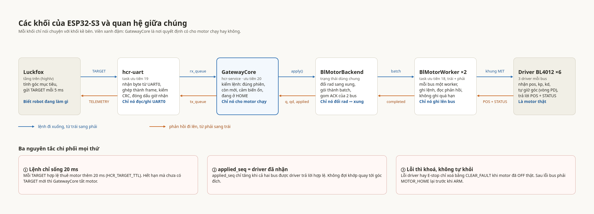
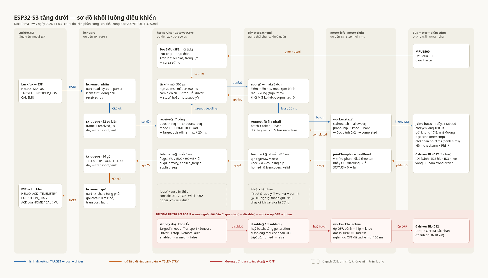

# Sơ đồ khối ESP32-S3 (tầng dưới)

Có hai sơ đồ, đều dùng tên thật trong mã nguồn. Xem **sơ đồ 1** để nắm các khối
và quan hệ giữa chúng, rồi **sơ đồ 2** khi cần biết từng khối làm gì bên trong.

## 1. Các khối và quan hệ giữa chúng (tổng quan)

Sáu khối nối tiếp nhau: Luckfox → `hcr-uart` → `GatewayCore` → `BlMotorBackend`
→ `BlMotorWorker` ×2 → driver BL4012 ×6. Mỗi khối chỉ nói chuyện với khối kề bên.
Lệnh đi từ trái sang phải (xanh), phản hồi đi từ phải sang trái (cam). Nhãn trên
mũi tên là tên thật của thứ được truyền (`TARGET`, `rx_queue`, `apply()`,
`batch`, khung MIT, `TELEMETRY`, `tx_queue`, `completed`, `POS + STATUS`).

| Khối | Là gì trong mã | Việc chính |
|---|---|---|
| Luckfox | tầng `highlv` | Tính góc mục tiêu, gửi `TARGET` |
| `hcr-uart` | task ưu tiên 19 (`main.cpp`) | Nhận byte từ UART0, ghép frame, kiểm CRC, đóng dấu giờ nhận; gửi telemetry |
| `GatewayCore` | `src/core/GatewayCore.cpp`, chạy trong task `hcr-service` (ưu tiên 20) | Kiểm lệnh và quyết định có cho motor chạy hay không |
| `BlMotorBackend` | `src/motor/BlMotor.cpp` | Đổi rad sang xung, gói `batch`, gom ACK của hai bus |
| `BlMotorWorker` ×2 | task `motor-left`, `motor-right` (ưu tiên 18) | Mỗi bus một worker; ghi lệnh, đọc phản hồi, không ghi quá hạn |
| Driver BL4012 ×6 | phần cứng, 3 driver mỗi bus | Nhận `pos`, `kp`, `kd`; tự giữ góc; trả lời `POS + STATUS` |

`GatewayCore` (viền xanh đậm) là nơi duy nhất quyết định có cho motor chạy hay
không. Ba nguyên tắc ở cuối hình chi phối mọi thứ còn lại:

1. Lệnh chỉ sống 20 ms (`HCR_TARGET_TTL`); hết hạn mà chưa có `TARGET` mới thì
   `GatewayCore` tắt motor.
2. `applied_seq` chỉ tăng khi cả hai bus được driver trả lời hợp lệ; không đợi
   khớp quay tới góc đích.
3. Lỗi thì khoá, không tự khỏi; lỗi driver hay E-stop chỉ xoá bằng `CLEAR_FAULT`
   khi motor đã OFF thật, và sau lỗi bus phải `MOTOR_HOME` lại trước khi ARM.

- Ảnh: [assets/esp_layers_overview.png](assets/esp_layers_overview.png)
  (2064 × 744); nguồn HTML: [assets/esp_layers_overview.html](assets/esp_layers_overview.html).

## 2. Luồng điều khiển chi tiết

Toàn bộ khối `lowlv`: từ dây UART với Luckfox, qua `GatewayCore`,
`BlMotorBackend`, hai worker, bus một dây, tới sáu driver BL4012, và đường ngược
lại của cảm biến.

- Ảnh: [assets/esp_block_diagram.png](assets/esp_block_diagram.png) (2228 × 1272).
- Nguồn có thể mở trực tiếp bằng trình duyệt:
  [assets/esp_block_diagram.html](assets/esp_block_diagram.html). Đây là HTML
  độc lập, không cần runtime nào; ảnh PNG được render từ chính file này.

Cả hai sơ đồ có bản chỉnh sửa được trên canvas Claude Design (riêng tư, chỉ chủ
sở hữu mở được): `https://claude.ai/artifact/Y4yuy9reFzkU4naHZzTugM`. Mỗi thẻ và
mũi tên ở đó là phần tử đặt riêng nên kéo và sửa chữ từng ô được. Các file trong
`docs` là ảnh chụp tại thời điểm tạo; sửa canvas không tự cập nhật chúng.

### Cách đọc sơ đồ 2

Sáu cột (lane) từ trái sang phải là sáu "chủ sở hữu" khác nhau. Màu mũi tên có ý
nghĩa:

| Màu | Nghĩa | Đường đi chính |
|---|---|---|
| Xanh dương | Lệnh đi xuống | Luckfox → `hcr-uart` → `rx_queue` → `receive()` → `tick()` → `apply()` → `request_[trái/phải]` → `worker.step()` → `joint_bus.c` → driver |
| Cam | Dữ liệu đi lên | IMU / driver → `jointSample`/`wheelRead` → `feedback()` → `telemetry()` → `tx_queue` → `hcr-uart` → Luckfox |
| Đỏ | Đường dừng an toàn | `stop(lý do)` → `disable()` → worker ép OFF → đọc lại `0x18` ở sáu driver |
| Ô gạch đứt | Ghi chú | Không nằm trên luồng dữ liệu |

Các cặp mũi tên ngược chiều giữa hai thẻ là hai việc khác nhau, không phải một
vòng lặp thừa:

| Cặp | Xanh (xuống) | Cam (lên) |
|---|---|---|
| `tick()` ↔ `apply()` | `apply()`: gửi TARGET, hạn và seq | `applied`: kết quả `Applied` kèm `applied_seq` |
| `request_[…]` ↔ `worker.step()` | `batch`: lô lệnh kèm token và lease | `completed`: worker báo `completed == token` |
| `worker.step()` ↔ bus | `khung MIT`: 17 byte ghi vào thanh ghi `0x1A` | `phản hồi`: vị trí và STATUS của driver |

## Bốn điều cần nhớ khi nhìn sơ đồ

1. **Chỉ `hcr-service` chạy `GatewayCore`; chỉ worker mới ghi bus.** Core không
   bao giờ chờ bus. Nó đặt một batch vào `request_[…]` rồi hỏi lại ở tick sau.
2. **ACK đi đường cam, không đi đường xanh.** `applied_seq` chỉ tăng khi cả hai
   bus báo `completed == token`; telemetry mang nó về Luckfox.
3. **Mọi lỗi dồn về `stop()`.** Sơ đồ không vẽ từng mũi tên từ nơi phát sinh lỗi
   tới `stop()` (sẽ cắt ngang các thẻ); các nguồn được liệt kê trong thẻ
   `tick()` và `stop(lý do)`: hết hạn 20 ms, mất LF 500 ms, cảm biến cũ,
   E-stop, lỗi driver, gói UART TX chờ quá 10 ms, STATUS lỗi từ LF.
4. **Hạn thuê 20 ms được kiểm ở bốn lớp** (ô gạch đứt ở cột `BlMotorBackend`),
   hai lớp trong số đó chạy được cả khi `hcr-service` bị đứng.

## Độ tin cậy

Sơ đồ được vẽ từ việc đọc mã nguồn `lowlv` ngày 2026-11-03 (gồm các thay đổi chưa
commit lúc đó), không từ phép đo hay test trên phần cứng. Con số thời gian
(`500 µs`, `5 ms`, `3 ms`/`9 ms`, `100 µs`) là hằng số trong code. Nội dung bên
trong driver BL4012 ("vòng PD nằm trong driver") dựa trên chú thích trong
`MotorFrameCodec.hpp`, chưa đối chiếu với tài liệu hãng. Khi mã thay đổi, sơ đồ
phải được cập nhật thủ công.

Giải thích từng bước và công thức nằm trong [CONTROL_FLOW.md](CONTROL_FLOW.md);
đặc tả frame ở [HCR1_PROTOCOL.md](HCR1_PROTOCOL.md); chi tiết ghép motor ở
[MOTOR_INTEGRATION.md](MOTOR_INTEGRATION.md).
